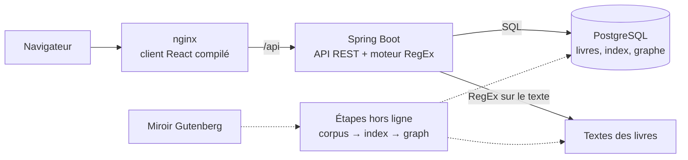

# Moteur de recherche de livres

Moteur de recherche sur plus de 2000 livres du projet Gutenberg. Il propose la recherche par mot-clé et par expression régulière, classe les résultats par centralité dans un graphe de similarité (Jaccard) et propose des suggestions grâce aux distances de Jaccard.

**Java 21 · Spring Boot 4 · PostgreSQL 18 · React 19 · TypeScript · Docker Compose**

Projet de Master 2 informatique à Sorbonne Université (UE DAAR), réalisé en binôme par Ramy SAIL et Younes Bensallah, en novembre 2026.

## Résumé

Le projet couvre toute la chaîne d'un moteur de recherche, de la collecte des documents à l'interface :

1. **Collecte** : 2000 livres anglais, téléchargés depuis un miroir de Gutenberg puis nettoyés. Cela fait 156 millions de mots et 846 Mo de texte.
2. **Indexation** : un index inversé de 13 millions de lignes (mot, livre, nombre d'occurrences), stocké dans PostgreSQL.
3. **Graphe de similarité** : la distance de Jaccard entre chaque paire de livres définit un graphe. On y calcule deux centralités, closeness et PageRank.
4. **Recherche en ligne** : une API REST et un client React offrent :
   - la recherche par mot-clé ;
   - la recherche par expression régulière, sur le vocabulaire de l'index (rapide) ou sur le texte intégral (lente) ;
   - le classement des résultats par nombre d'occurrences, par closeness ou par PageRank ;
   - des suggestions : les voisins des meilleurs résultats dans le graphe.

Le calcul coûteux se fait une seule fois, hors ligne. En ligne, une recherche se réduit à quelques lectures dans des tables déjà prêtes.

## Architecture



- Un seul jar Spring Boot sert l'API. Lancé avec le nom d'une étape (`corpus`, `index` ou `graph`), il fait à la place le précalcul hors ligne.
- L'accès à la base passe par du SQL écrit à la main (`JdbcClient`), sans ORM. On garde ainsi la main sur les requêtes de recherche et sur les chargements en masse.
- Docker Compose lance trois conteneurs (PostgreSQL, serveur, nginx) sur deux réseaux séparés : le client n'atteint jamais la base.

## Points techniques

**Indexation** ([`InvertedIndex`](server/src/main/java/engine/indexing/InvertedIndex.java), [`IndexStep`](server/src/main/java/engine/indexing/IndexStep.java))
- Les livres sont découpés en mots en parallèle. L'index est ensuite inversé par un tri par dénombrement, en O(V log V + R) pour V termes et R lignes.
- Le chargement passe par `COPY`, clés retirées puis recréées : PostgreSQL construit ses index en une seule passe au lieu de ligne à ligne.

**Graphe de Jaccard et centralités** ([`Jaccard`](server/src/main/java/engine/graph/Jaccard.java), [`ThresholdGraph`](server/src/main/java/engine/graph/ThresholdGraph.java), [`Closeness`](server/src/main/java/engine/graph/Closeness.java), [`PageRank`](server/src/main/java/engine/graph/PageRank.java))
- Chaque livre devient deux tableaux d'entiers triés. La distance entre deux livres est alors une simple fusion linéaire, et les 2 millions de paires se calculent en parallèle en 26 s.
- Le seuil du graphe est choisi automatiquement : c'est le plus petit qui donne un degré moyen d'au moins 20.
- Closeness (parcours en largeur parallèles) et PageRank pondéré prennent chacun une dizaine de millisecondes. Les livres sans voisin reçoivent un traitement à part.

**Expressions régulières** ([`egrep/`](egrep/), [`IndexRegexSearch`](server/src/main/java/engine/search/IndexRegexSearch.java), [`TextRegexSearch`](server/src/main/java/engine/search/TextRegexSearch.java))
- Le moteur RegEx est écrit de zéro, lors d'un projet précédent : analyse syntaxique, automate d'Aho-Ullman, déterminisation, minimisation de Moore, et KMP quand le motif est un simple mot. Il est réutilisé ici tel quel, comme bibliothèque.
- Sur l'index, l'automate minimal teste les 517 845 termes du vocabulaire, gardés en mémoire. Une requête SQL regroupe ensuite les livres qui contiennent les termes reconnus.
- Sur le texte intégral, les livres sont relus en parallèle. Un sémaphore limite ces requêtes lentes à deux à la fois.

**API et client** ([`engine/api/`](server/src/main/java/engine/api/), [`client/src/`](client/src/))
- Six routes `GET`. Les erreurs suivent le format standard Problem Details (RFC 9457).
- Le client garde l'état de la recherche dans l'URL, si bien que le rechargement et le bouton Retour fonctionnent. Une réponse qui arrive après une requête plus récente est ignorée.

**Tests et mesures**
- Environ 190 tests JUnit, dont des tests d'intégration sur une vraie base PostgreSQL jetable (Testcontainers).
- Le jar contient aussi des étapes de mesure : passage à l'échelle de 100 à 2000 livres, temps des recherches et test de charge. Leurs résultats sont dans [`measures/`](measures/) et le rapport les analyse.

## Limites et pistes

- Le classement par nombre d'occurrences favorise les livres longs. Un score tf-idf ou BM25 serait plus juste.
- 30 % des livres, surtout les plus courts, n'ont aucun voisin dans le graphe de seuil. Un graphe des k plus proches voisins le compléterait.
- Jaccard compare toutes les paires, en O(n²). Sur Gutenberg entier (plus de 70 000 livres), il faudrait une approximation comme MinHash et LSH.

## Lancer le projet

### Prérequis

- **Docker**, avec Docker Compose : il suffit pour lancer l'application.
- **Java 21** ou plus récent : seulement pour lancer les tests.

### Avec Docker

Les textes des livres ne sont pas dans le dépôt : l'étape `corpus` les télécharge à nouveau, à l'identique, d'après la liste [`corpus/ids.txt`](corpus/ids.txt).

```sh
# construit les images, puis démarre la base, le serveur et le client
docker compose up -d --build

# télécharge les livres depuis un miroir de Gutenberg :
# 50 livres en 5 à 10 minutes, pour essayer...
docker compose run --rm server corpus --limit=50
# ... ou les 2000 livres du corpus, en 3 à 5 heures selon le débit du miroir
docker compose run --rm server corpus

# construit l'index inversé
docker compose run --rm server index

# calcule le graphe de Jaccard et les centralités (closeness, PageRank)
docker compose run --rm server graph
```

L'application répond sur http://localhost:8080. Les recherches fonctionnent dès la fin de `graph`, sans redémarrage.

### Tests

Seuls les tests ne passent pas par Docker Compose :

```sh
# tests JUnit du moteur RegEx et du serveur ; Docker doit tourner, pour le PostgreSQL jetable de Testcontainers
make test        # ou, sans make : ./mvnw test
```

### Précalcul hors ligne

Trois étapes du jar, dans cet ordre. Le rapport décrit leurs algorithmes.

| Étape | Effet | Option |
|---|---|---|
| `corpus` | télécharge les livres de `corpus/ids.txt`, sans l'en-tête ni le pied de page de Gutenberg, et remplit la table `book` ; une pause de 2 s sépare deux téléchargements ; interrompue, l'étape reprend où elle en était | `--limit=N` : les N premiers livres seulement |
| `index` | construit l'index inversé : tables `term` et `occurrence` | |
| `graph` | calcule les distances de Jaccard, le graphe de seuil, closeness et PageRank : table `neighbor` et colonnes de `book` ; écrit `distances.csv`, `centralities.csv` et `edges.csv` dans `measures/` | `--theta=θ` : le seuil ; par défaut, le plus petit qui donne un degré moyen d'au moins 20 |

Relancer `corpus` vide l'index et le graphe, qu'il faut alors recalculer.

Réglages, par variables d'environnement : `DB_URL`, `DB_USER`, `DB_PASSWORD` (par défaut, le conteneur de `docker-compose.yml`), `DATA_DIR` (textes des livres, `data/`), `CORPUS_IDS`, `GUTENBERG_MIRROR` (`https://gutenberg.pglaf.org`), `MEASURES_DIR` (`measures/`).

### Mesures

Les CSV de `measures/` viennent de quatre étapes du jar, lancées sur le corpus complet après `graph` (dans Docker : `docker compose run --rm server <étape>`). Le rapport présente leur méthode et leurs résultats.

- `index-scaling`, `graph-scaling` : passage à l'échelle de l'index, de Jaccard et des centralités, sur des échantillons de 100 à 2000 livres (`--runs=N`) ;
- `bench` : temps des recherches dans le serveur, sans réseau (`--runs=N`) ;
- `load` : test de charge de l'API d'un serveur déjà lancé (`--url=`, `--seconds=`, `--levels=`). `load-docker.csv` est le même test, à travers nginx, contre l'application de `docker compose up`.
